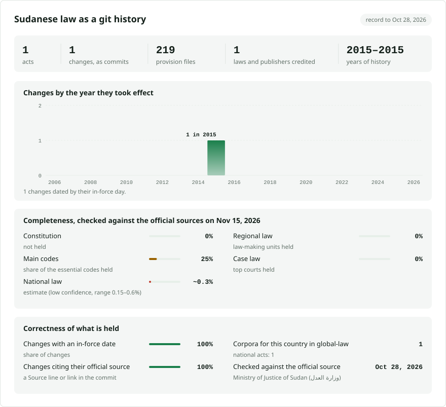

# Sudan: law history in git

[العربية](README.md) · **English**

<picture>
<source media="(prefers-color-scheme: dark)" srcset="data/effort-dark.svg">

</picture>

The law of Sudan as a git history: one file per section, one commit per version on the day it took effect, and the law that made each change as the commit's author. `git blame` names the law behind every line; `git log` lists every change to a section; picking a date gives the text in force that day.

Part of [lexifina/global-law](https://github.com/lexifina/global-law), one git history for every country's law: this is Sudan's national law, which global-law reads at `sudan/national/acts/`.

**What is in it now:** one act, the Criminal Act 1991 (القانون الجنائي لسنة 1991), in one version: the text in the Ministry of Justice's 9th Revised Edition of the Laws of Sudan, which holds the laws in force on 30 March 2015 (sections 1 to 185 with 88A and 88B, 29 part and chapter headings and 2 schedules). [`data/versions.json`](data/versions.json) lists the act with its version and source, and [`criminal-act-1991/README.md`](criminal-act-1991/README.md) lists its files.

The act is in `criminal-act-1991/`, one file per section: `criminal-act-1991/art-174.md` is section 174, theft (السرقة); part and chapter headings are in the `part-*.md` files, the schedules in `schedule-01.md` and `schedule-02.md`.

The text is in Arabic, as the Ministry of Justice's edition prints it, with each section's marginal note as its heading. An English translation is not part of this record.

## Questions as git commands

| Question | Command |
| --- | --- |
| Every change to section 174 of the Criminal Act | `git log -p --word-diff -- criminal-act-1991/art-174.md` |
| Which law wrote each line of section 174? | `git blame criminal-act-1991/art-174.md` |
| Every version of the Criminal Act, with the day each took effect | `git log --format="%h %(trailers:key=In-force,valueonly,separator=) %an" -- criminal-act-1991 ':!*/README.md'` |
| Section 174 as in force on 30 March 2015 | `python tools/on.py 2015-03-30 criminal-act-1991 174` |

**Outside git**, we also host this record publicly, for free:

- **[Ask Claude about Sudanese law](https://global-law.lexifina.com/v1/try_claude?country=sudan)**: opens Claude with a first question ready.
- **[Ask ChatGPT](https://global-law.lexifina.com/v1/try_chatgpt?country=sudan)**: the same question in ChatGPT.
- **[Search Sudanese law on our site](https://lexifina.com/law?country=sudan&q=%D8%A7%D9%84%D8%B3%D8%B1%D9%82%D8%A9)**: a search for "السرقة" (theft), with each provision's text and its versions, no account needed.
- **[Developer REST API](https://global-law.lexifina.com/v1/search_law?query=%D8%A7%D9%84%D8%B3%D8%B1%D9%82%D8%A9&jurisdiction=sudan)**: the same search as JSON, with no key. See the [documentation here](https://lexifina.com/api/global-law).

Both assistants read the record through the free Global law connector (MCP, `https://global-law.lexifina.com/mcp`); the first time, the chat gives you the link that adds it. Ask in Arabic or in English.

**Host it yourself easily.** All it takes is git and Python, and the tools run on your machine:

```sh
git clone --depth 1 https://github.com/lexifina/global-law && cd global-law
python3 tools/countries.py add sudan/national/acts
python3 tools/law.py show 2026-01-01 sudan/national/acts/criminal-act-1991/art-174.md
```

Opened in Claude Code, Cursor, VS Code or Codex, the clone also starts a local MCP server with the same tools ([MCP.md](https://github.com/lexifina/global-law/blob/main/MCP.md)).

## Dates

Each commit is dated at noon, Africa/Khartoum, on the day the version took effect, and carries it in its `In-force:` trailer:

- the Criminal Act's one version is dated 30 March 2015, the day to which the 9th Revised Edition says it holds the laws in force; it is not the act as enacted (published in the Gazette on 20 February 1991, as the edition's first footnote says);
- the edition's footnotes name the laws behind some sections (among them Acts No. 15 of 2009, 20 of 2012 and 21 of 2015) but give no day for each change, so they are listed in the commit message, not committed as versions.

The version is labelled "oldest version available" and credited to the publisher, `Ministry of Justice of Sudan (وزارة العدل)`, not to a law. The committer is Lexifina.

## How it is checked

- `tools/check_repo.py` reads every version back from git on the day it took effect and on the day before, compares it file by file with the corpus it was built from, and checks every commit's trailers; [`REPRODUCE.md`](REPRODUCE.md) does not yet record a run for this build.
- The Criminal Act was read again from the Ministry's live edition on 30 October 2026: every file matched.
- The wording is as printed: footnote markers are dropped, spacing is normalised and marginal notes become headings; nothing else is changed (see `LICENSE`).
- The same corpus always gives the same commit hashes (`tools/build.py`); `main` has no merge commits and no commit dated in the future.

## What it does not show

- **Changes after 30 March 2015.** The Criminal Act has been amended since (in 2020, among other years); no later change is applied, so a section may differ from the text in force today.
- **The act as enacted in 1991**, or any version before the edition's.
- **Most of Sudan's law.** The 9th Revised Edition holds 332 acts in 14 volumes; one is here. The Civil Transactions Act 1984 was left out because its parse was not complete. Regulations, case law and bills are not here.
- **The Constitution.** The 2019 Constitutional Charter and its 2020 and 2025 amendments are Gazette scans with no text layer, and no text is read by OCR.

## Sources

| Source | Kind | Past versions | Notes |
| --- | --- | --- | --- |
| [Ministry of Justice of Sudan, قوانين السودان](https://www.moj.gov.sd/sudanlaws/) | Official 9th Revised Edition of the Laws of Sudan | no, each act as in force on 30 March 2015 | Retrieved 28 October 2026; footnotes name amending laws without dates |

## Licence

See [`LICENSE`](LICENSE). Laws are not protected by copyright in Sudan: the Copyright and Neighbouring Rights Protection and Literal and Artistic Works Act, 2013, section 6(b), excludes official documents, which section 2 defines to include laws. Lexifina's own contributions (the arrangement of the history, the commit messages and the tools) are CC0 1.0.

No AI model wrote, translated or corrected legal text, and none runs when the history is built; the scripts were written by an AI model (see [`REPRODUCE.md`](REPRODUCE.md)).

## More

From [lexifina/global-law](https://github.com/lexifina/global-law):

- [FEATURES.md](https://github.com/lexifina/global-law/blob/main/FEATURES.md): every feature, and what every corpus must support (`git blame`, `law.py`, the MCP tools)
- [FAQ.md](https://github.com/lexifina/global-law/blob/main/FAQ.md): questions and answers · [CONTRIBUTING.md](https://github.com/lexifina/global-law/blob/main/CONTRIBUTING.md): proposing changes · [MCP.md](https://github.com/lexifina/global-law/blob/main/MCP.md): the MCP server · [REPRODUCE.md](https://github.com/lexifina/global-law/blob/main/REPRODUCE.md): how it was built · [CHANGELOG.md](https://github.com/lexifina/global-law/blob/main/CHANGELOG.md)
- [FRESHNESS.md](https://github.com/lexifina/global-law/blob/main/FRESHNESS.md): how current each corpus is · [Monitoring](https://github.com/lexifina/global-law/tree/main/monitoring): whether updates are running · [WATCHING.md](https://github.com/lexifina/global-law/blob/main/WATCHING.md): how each official source is watched for changes
- [performance/](https://github.com/lexifina/global-law/tree/main/performance): how fast the tools are, measured
- [visualisations/](https://github.com/lexifina/global-law/tree/main/visualisations): charts and bridges across the world's law
- [Vulnerabilities](https://github.com/lexifina/global-law/tree/main/vulnerabilities): mistakes in legislation as published
