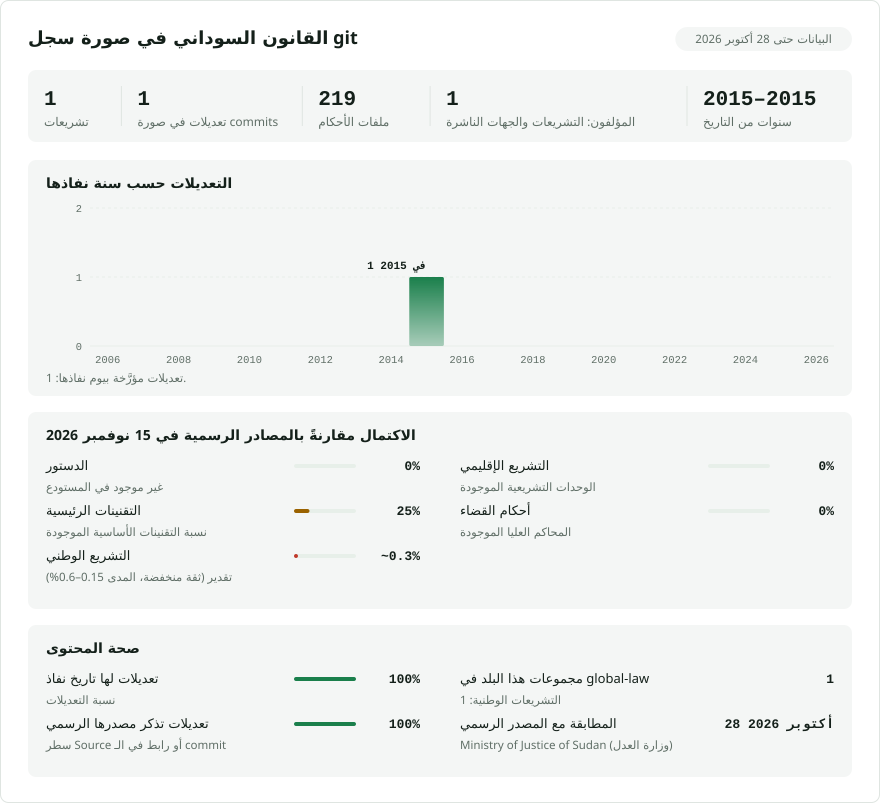

# السودان: تاريخ القانون في git

**العربية** · [English](README.en.md)

<picture>
<source media="(prefers-color-scheme: dark)" srcset="data/ar/effort-dark.svg">

</picture>

القانون السوداني في صورة سجل git: ملف واحد لكل مادة، وcommit واحد لكل نسخة في يوم نفاذها، والقانون الذي أجرى كل تعديل هو مؤلف الـ commit. يذكر `git blame` القانون الذي يقف وراء كل سطر؛ ويسرد `git log` كل تعديل طرأ على مادة ما؛ واختيار تاريخ ما يعطي النص النافذ في ذلك اليوم.

جزء من [lexifina/global-law](https://github.com/lexifina/global-law)، وهو سجل git واحد لقوانين جميع الدول: هذا هو القانون الوطني السوداني، الذي يقرؤه global-law في `sudan/national/acts/`.

**ما يحتويه الآن:** قانون واحد، هو القانون الجنائي لسنة 1991، في نسخة واحدة: النص الوارد في الطبعة المنقحة التاسعة لقوانين السودان الصادرة عن وزارة العدل، التي تضم القوانين السارية في 30 مارس 2015 (المواد من 1 إلى 185 مع المادتين 88 أ و88 ب، و29 عنوانًا للأبواب والفصول، وجدولان). يسرد [`data/versions.json`](data/versions.json) القانون مع نسخته ومصدره، ويسرد [`criminal-act-1991/README.md`](criminal-act-1991/README.md) ملفاته.

القانون في `criminal-act-1991/`، ملف واحد لكل مادة: `criminal-act-1991/art-174.md` هي المادة 174، السرقة؛ وعناوين الأبواب والفصول في ملفات `part-*.md`، والجدولان في `schedule-01.md` و`schedule-02.md`.

النص باللغة العربية، كما تطبعه طبعة وزارة العدل، والعنوان الجانبي لكل مادة عنوانٌ لها. والترجمة الإنجليزية ليست جزءًا من هذا السجل.

## الأسئلة بصيغة أوامر git

| السؤال | الأمر |
| --- | --- |
| كل تعديل طرأ على المادة 174 من القانون الجنائي | `git log -p --word-diff -- criminal-act-1991/art-174.md` |
| أي قانون كتب كل سطر من المادة 174؟ | `git blame criminal-act-1991/art-174.md` |
| كل نسخ القانون الجنائي، مع يوم نفاذ كل منها | `git log --format="%h %(trailers:key=In-force,valueonly,separator=) %an" -- criminal-act-1991 ':!*/README.md'` |
| المادة 174 كما كانت نافذة في 30 مارس 2015 | `python tools/on.py 2015-03-30 criminal-act-1991 174` |

**خارج git**، نستضيف هذا السجل أيضًا للعموم مجانًا:

- **[اسأل Claude عن القانون السوداني](https://global-law.lexifina.com/v1/try_claude?country=sudan)**: يفتح Claude مع سؤال أول جاهز.
- **[اسأل ChatGPT](https://global-law.lexifina.com/v1/try_chatgpt?country=sudan)**: السؤال نفسه في ChatGPT.
- **[ابحث في القانون السوداني على موقعنا](https://lexifina.com/law?country=sudan&q=%D8%A7%D9%84%D8%B3%D8%B1%D9%82%D8%A9)**: بحث عن "السرقة"، مع نص كل حكم ونسخه، دون الحاجة إلى حساب.
- **[واجهة REST API للمطورين](https://global-law.lexifina.com/v1/search_law?query=%D8%A7%D9%84%D8%B3%D8%B1%D9%82%D8%A9&jurisdiction=sudan)**: البحث نفسه بصيغة JSON، دون مفتاح. انظر [التوثيق هنا](https://lexifina.com/api/global-law).

يقرأ كلا المساعدَين السجلَّ عبر موصل Global law المجاني (MCP، `https://global-law.lexifina.com/mcp`)؛ وفي المرة الأولى تعطيك المحادثة الرابط الذي يضيفه. اسأل بالعربية أو بالإنجليزية.

**استضِفه بنفسك بسهولة.** كل ما يلزم هو git وPython، والأدوات تعمل على جهازك:

```sh
git clone --depth 1 https://github.com/lexifina/global-law && cd global-law
python3 tools/countries.py add sudan/national/acts
python3 tools/law.py show 2026-01-01 sudan/national/acts/criminal-act-1991/art-174.md
```

عند فتح النسخة المستنسخة في Claude Code أو Cursor أو VS Code أو Codex، تشغّل أيضًا خادم MCP محليًا بالأدوات نفسها ([MCP.md](https://github.com/lexifina/global-law/blob/main/MCP.md)).

## التواريخ

يحمل كل commit تاريخ الظهر، بتوقيت Africa/Khartoum، من يوم نفاذ النسخة، ويذكر هذا التاريخ في حقله الختامي (trailer) `In-force:`:

- النسخة الوحيدة من القانون الجنائي مؤرَّخة في 30 مارس 2015، وهو اليوم الذي تذكر الطبعة المنقحة التاسعة أنها تضم القوانين السارية حتى تاريخه؛ وهي ليست القانون كما صدر (المنشور في الجريدة الرسمية في 20 فبراير 1991، كما تذكر أول حاشية في الطبعة)؛
- تذكر حواشي الطبعة القوانين التي تقف وراء بعض المواد (ومنها القوانين رقم 15 لسنة 2009 و20 لسنة 2012 و21 لسنة 2015)، لكنها لا تذكر يومًا لكل تعديل، لذا فهي مدرجة في رسالة الـ commit، لا مسجّلة في صورة نسخ.

النسخة موسومة بعبارة "oldest version available" (أقدم نسخة متاحة) ومنسوبة إلى الناشر، `Ministry of Justice of Sudan (وزارة العدل)`، لا إلى قانون. وصاحب الـ commit (committer) هو Lexifina.

## طريقة التحقق

- يعيد `tools/check_repo.py` قراءة كل نسخة من git في يوم نفاذها وفي اليوم السابق له، ويقارنها ملفًا ملفًا بالمجموعة التي بُنيت منها، ويتحقق من الحقول الختامية لكل commit؛ ولا يسجّل [`REPRODUCE.md`](REPRODUCE.md) بعدُ أي تشغيل لهذا البناء.
- أُعيدت قراءة القانون الجنائي من الطبعة المنشورة حاليًا على موقع الوزارة في 30 أكتوبر 2026: وتطابقت جميع الملفات.
- الصياغة كما طُبعت: حُذفت علامات الحواشي، ووُحِّدت المسافات، وأصبحت العناوين الجانبية عناوين؛ ولم يُغيَّر شيء آخر (انظر `LICENSE`).
- المجموعة نفسها تعطي دائمًا قيم تجزئة الـ commits نفسها (`tools/build.py`)؛ ولا يحتوي `main` على commits دمج (merge) ولا على commit مؤرَّخ في المستقبل.

## ما لا يتضمنه

- **التعديلات اللاحقة لـ 30 مارس 2015.** عُدِّل القانون الجنائي منذ ذلك الحين (في 2020، ضمن سنوات أخرى)؛ ولم يُطبَّق أي تعديل لاحق، لذا قد تختلف مادة ما عن النص النافذ اليوم.
- **القانون كما صدر في 1991**، أو أي نسخة سابقة لنسخة الطبعة.
- **معظم القانون السوداني.** تضم الطبعة المنقحة التاسعة 332 قانونًا في 14 مجلدًا؛ وواحد منها فقط هنا. واستُبعد قانون المعاملات المدنية لسنة 1984 لأن تحليله لم يكتمل. واللوائح وأحكام القضاء ومشاريع القوانين ليست هنا.
- **الدستور.** الوثيقة الدستورية لسنة 2019 وتعديلاتها لسنتي 2020 و2025 صور ممسوحة من الجريدة الرسمية بلا طبقة نصية، ولا يُقرأ أي نص بالتعرف الضوئي على الحروف (OCR).

## المصادر

| المصدر | النوع | النسخ السابقة | ملاحظات |
| --- | --- | --- | --- |
| [وزارة العدل السودانية، قوانين السودان](https://www.moj.gov.sd/sudanlaws/) | الطبعة المنقحة التاسعة الرسمية لقوانين السودان | لا، كل قانون كما كان ساريًا في 30 مارس 2015 | استُرجعت في 28 أكتوبر 2026؛ تذكر الحواشي القوانين المعدِّلة دون تواريخ |

## الترخيص

انظر [`LICENSE`](LICENSE). القوانين غير محمية بحق المؤلف في السودان: إذ يستثني قانون حماية حق المؤلف والحقوق المجاورة والمصنفات الأدبية والفنية لسنة 2013، في المادة 6(ب)، الوثائق الرسمية، التي تعرّفها المادة 2 بحيث تشمل القوانين. أما إسهامات Lexifina الخاصة (ترتيب السجل، ورسائل الـ commits، والأدوات) فخاضعة لـ CC0 1.0.

لم يكتب أي نموذج ذكاء اصطناعي نصًا قانونيًا ولم يترجمه ولم يصحّحه، ولا يعمل أي نموذج عند بناء السجل؛ أما البرامج النصية فقد كتبها نموذج ذكاء اصطناعي (انظر [`REPRODUCE.md`](REPRODUCE.md)).

هذا النص ترجمة للنسخة الإنجليزية ([README.en.md](README.en.md))؛ وعند الاختلاف تسود النسخة الإنجليزية.

## المزيد

من مستودع [lexifina/global-law](https://github.com/lexifina/global-law) (صفحات باللغة الإنجليزية):

- [FEATURES.md](https://github.com/lexifina/global-law/blob/main/FEATURES.md): جميع الميزات، وما يجب أن تدعمه كل مجموعة (`git blame`، `law.py`، أدوات MCP)
- [FAQ.md](https://github.com/lexifina/global-law/blob/main/FAQ.md): أسئلة وأجوبة · [CONTRIBUTING.md](https://github.com/lexifina/global-law/blob/main/CONTRIBUTING.md): اقتراح تغييرات · [MCP.md](https://github.com/lexifina/global-law/blob/main/MCP.md): خادم MCP · [REPRODUCE.md](https://github.com/lexifina/global-law/blob/main/REPRODUCE.md): طريقة البناء · [CHANGELOG.md](https://github.com/lexifina/global-law/blob/main/CHANGELOG.md)
- [FRESHNESS.md](https://github.com/lexifina/global-law/blob/main/FRESHNESS.md): مدى حداثة كل مجموعة · [المراقبة](https://github.com/lexifina/global-law/tree/main/monitoring): هل تعمل التحديثات · [WATCHING.md](https://github.com/lexifina/global-law/blob/main/WATCHING.md): كيف يُراقَب كل مصدر رسمي لرصد التغييرات
- [performance/](https://github.com/lexifina/global-law/tree/main/performance): سرعة الأدوات كما قيست
- [visualisations/](https://github.com/lexifina/global-law/tree/main/visualisations): رسوم بيانية وروابط عبر قوانين العالم
- [الثغرات](https://github.com/lexifina/global-law/tree/main/vulnerabilities): أخطاء في التشريعات كما نُشرت
